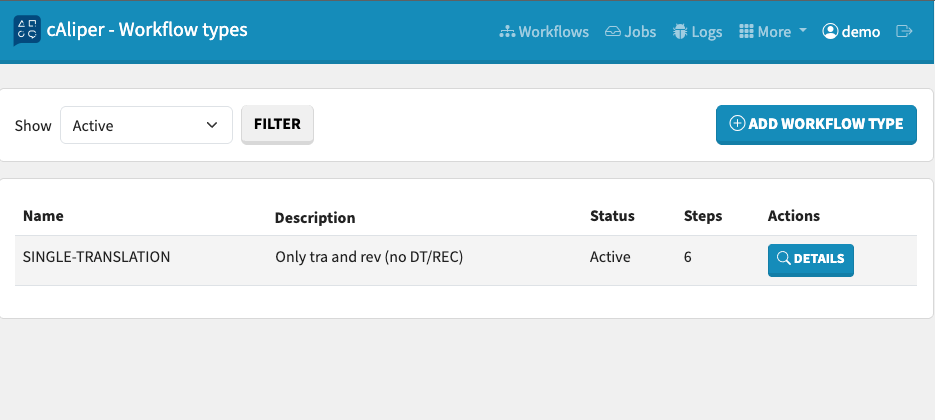
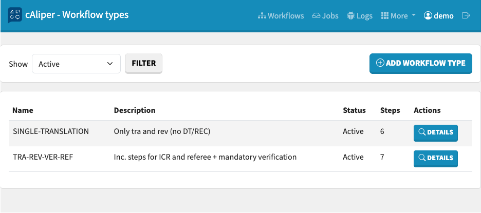
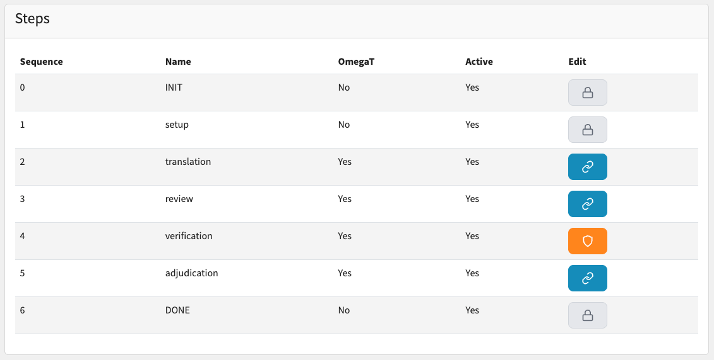
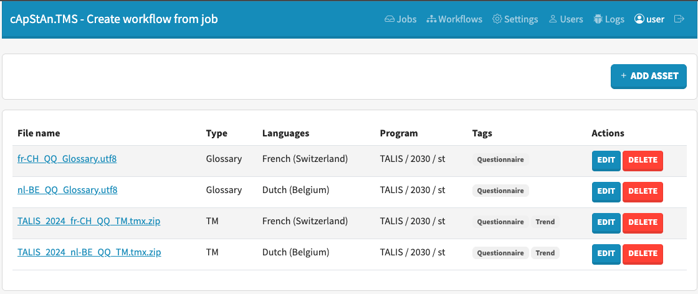

# Program preparation

Before creating workflows, the [PA and NPM](../00_introduction/#end-users) should make sure that the necessary resources are available. Workflow-type administration, including steps and roles, is a PA responsibility, whereas language assets can be managed by both the PA and the NPM.

> Tasks reserved for the PA are marked with a lock: :material-lock:

## Workflow types

A workflow type can be thought of as a template containing certain workflow properties, including the sequence of steps, that all workflows of that type will have and will be used to process a batch for every locale in a job. The PA creates and maintains workflow types for the program, whereas NPMs select one of them when creating workflows for a specific job.

<!-- NPM can skip locales -->
<!-- NPM can select one different type for different workflows for a certain job -->

!!! info
    The PA should configure workflow types to match the tasks required in the program. The workflow types used here, e.g. as `SINGLE-TRANSLATION` and `TRA-REV-VER-REF`, are examples of workflow types that could have been created by the PA. 

<!-- 

/// caption
The image above shows a workflow type created by the PA with the descriptive name `SINGLE-TRANSLATION`.
///
-->

/// caption
The image above shows two workflow types created by the PA with descriptive names `SINGLE-TRANSLATION` and `TRA-REV-VER-REF`.
///

### Fixed and configurable steps

Every workflow type includes three fixed system-defined steps, which cannot be removed or moved to a different position:

- **INIT** — the initial step, before the workflow has started
- **setup** — the step immediately after `INIT`
- **DONE** — the final step, after the workflow has been finalized
<!-- pending, closed -->

The PA can add, remove and reorder the steps between `setup` and `DONE`.

For each configurable step, the PA can:

- define the step name
- decide its position in the sequence
- mark it as **required** :material-shield:
- indicate whether it is an **OmegaT** step
- activate or deactivate it

A step marked **required** cannot be skipped manually by the NPM in the TMS. It must be completed in OmegaT (or moved by the PA if needed).

The **OmegaT** option must be checked for every step that represents a language task (to be performed in OmegaT). This may include tasks like translation (where the target version must be produced) or review, verification, adjudication and the like (where the target version may be edited). Steps that are administrative and do not involve an OmegaT task should not be marked as OmegaT steps.

!!! warning 
    The exact field names in the workflow type creation form may vary with the current interface. 

/// caption
The image above shows a workflow type including four language tasks, one of which is required: translation, review, verification (required) and adjudication.
///

### Managing workflow types :material-lock:

To create or maintain a workflow type:

1. Open the workflow type module.
2. Select **Add workflow type** to create a new template, or open an existing type clicking on **Details**.
3. Define the workflow type's identifying information and status.
4. Configure the steps between the fixed `setup` and `DONE` steps, adding, removing or sorting them as suitable.
5. For each language task step, select **OmegaT**. 
6. Mark **required** :material-shield: if you do not want the NPM to be able to skip the step manually.
6. Save the workflow type and ensure that it is active if it should be available to NPMs for new workflows.

## User roles

The user list displays the users configured in cAliper, including their username as well as their scope, step and locale restrictions. The scope determines what level a user has access to (the whole program, a specific country, or specific locales) whereas the step and locale restrictions specify what projects users will be assigned to.

<!-- 
The PA defines the roles that are available in the system and their scopes. 
--> 

!!! example inline end
    If the PA created role `reviser` for step "revision" in a certain workflow type, when the NPM creates a workflow for locale `qpm-IS` based on that workflow type, that workflow will have user `qpm-IS_reviser` assigned to step "revision".

The PA defines roles and assigns them to the steps in a workflow type. When a NPM creates workflows, specific users for that workflow are created based on the roles pre-defined by the PA. Users created for a specific workflow will have access to that workflow (i.e. to the batch in that locale) but not to other workflows. The NPM can add other existing users to a workflow if needed.

In a nutshell, the PA defines roles and roles become users when NPM creates workflows.

<!-- todo: Managing roles and users -->

## Language assets

Language assets include:

- **Translation memories (TMs)**: contain validated translations that can be reused during translation, e.g. from previous cycles of a program.
- **Bilingual glossaries**: contain validated terminology and phraseology, e.g. terms or expressions that must be translated a certain way.
- **Translation and adaptation (T&A) notes**: contain instructions and information that help the linguists deal with a certain difficulty or comply with certain requirements.

### Managing language assets

Press **Add asset** to add a resource. 

Existing assets can be edited or deleted from the list.

/// caption
The asset list shows each asset's file name, type, language, program, tags and available actions. 
///

!!! info
    Language assets must be prepared before creating workflows. When creating a workflow, cAliper will suggests language assets that match the workflow properties, based on the assets available in the system. 

<!-- todo: move to workflow creation -->

The NPM must review the suggestions for each locale, and change the selection as suitable, adding new assets or clearing suggested ones if not appropriate.

<!-- todo: move to workflow creation -->
!!! warning "NPM responsibility"
    It is the NPM's responsibility to check the suggested assets for every locale before saving the new workflow. It should not be assumed that the suggested assets will always be appropriate for every locale in a job.

[Next: Jobs :material-arrow-right:](02_jobs.md){ .md-button .md-button-right}