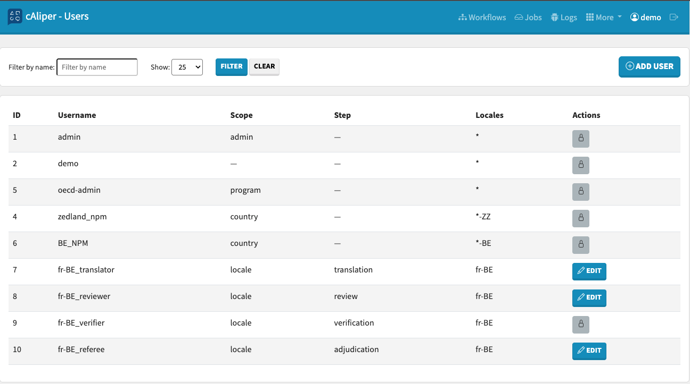
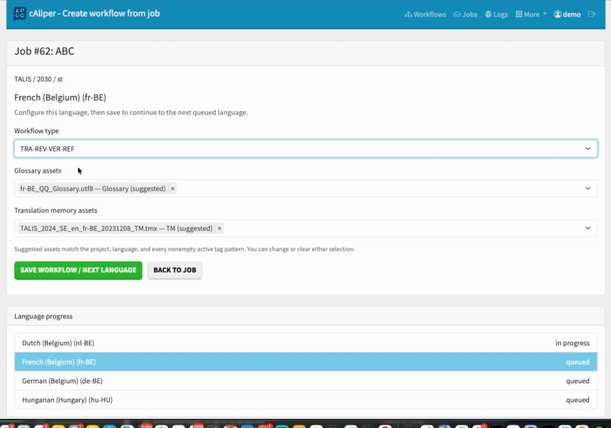

# Program preparation

Before creating workflows, the PA and NPM should make sure that the necessary resources are available. Workflow-type administration, including steps and roles, is a PA responsibility, whereas language assets can be managed by both the PA and the NPM.

> Tasks reserved for the PA are marked with a lock: :material-lock:

## Workflow types

A workflow type is a template containing certain workflow properties, including the sequence of steps, that will be used to process a batch for every locale in a job. Workflow types can be active or inactive. The PA creates and maintains them, whereas NPMs select an active workflow type when creating workflows for a specific job.

<!-- NPM can skip locales -->
<!-- NPM can select one different type for different workflows for a certain job -->

The examples shown here, such as `SINGLE-TRANSLATION` and `TRA-REV-VER-REF`, are examples only, not fixed workflow types. The PA should configure workflow types to match the tasks required in a program.

### Fixed and configurable steps

Every workflow type includes three fixed system-defined steps, which cannot be removed or moved:

- **pending** — the initial step
- **setup** — the step immediately after `pending`
- **closed** — the final step

The PA can add, remove and reorder the steps between `setup` and `closed`.

For each configurable step, the PA can:

- define the step name
- decide its position in the sequence
- mark it as **required**
- indicate whether it is an **OmegaT** step
- activate or deactivate it

A step marked **required** cannot be skipped manually by the NPM in the TMS. It must be completed in OmegaT, unless the PA moves it forward manually in the TMS.

Select the **OmegaT** option for every step that represents a language task to be performed in OmegaT. This may include translation, review, verification, adjudication or another editing task. Steps that are administrative and do not involve an OmegaT task should not be marked as OmegaT steps.

/// caption
The image above shows a workflow type including four language tasks, one of which is required: translation, review, verification (required) and adjudication.
///

!!! info 
    The exact field names in the workflow-type creation form may vary with the current interface. The important configuration decisions are the sequence of steps, their OmegaT setting, their required status and whether the workflow type is active.

### Managing workflow types :material-lock:

To create or maintain a workflow type:

1. Open the workflow type module.
2. Select **Add workflow type** to create a new template, or open the details of an existing type.
3. Define the workflow type's identifying information and status.
4. Configure the steps between the fixed `pending`, `setup` and `closed` steps. Add, remove or reorder the configurable steps as suitable.
5. For each language-task step, select **OmegaT**. 
6. Mark **required** if you do not want the NPM to be able to skip the step manually.
6. Save the workflow type and ensure that it is active if it should be available for new workflows.

/// caption
The image above shows two workflow types including four language tasks, one of which is required: translation, review, verification (required) and adjudication.
///

## User roles

The user list displays the users configured in cAliper, including their username, scope, step and locale restrictions. The scope determines where a user can work; a step or locale restriction can further limit the tasks available to them.

The PA defines the roles and scopes that are available in the system. The NPM can add users as needed within that framework, for the NPM's country or region. When adding a user, make sure that the account is associated with the appropriate scope, locale and workflow step.

The exact fields and validation rules in the **Add user** form are not documented in the presentation; follow the labels and validation messages shown in the current cAliper interface.

## Language assets

Language assets include:

- **Translation memories (TMs):** contain validated translations that can be reused during translation, e.g. from previous cycles of a program.
- **Bilingual glossaries:** contain validated terminology and phraseology.
- **Translation and adaptation (T&A) notes**: contain instructions and information that help the linguists deal with a certain difficulty or comply with certain requirements

The asset list shows each asset's file name, type, language, program, tags and available actions. Use **Add asset** to add a resource. Existing assets can be edited or deleted from the list.

When creating a workflow, cAliper suggests glossary and TM assets that match the project, language and applicable active tags. Review the suggestions for each locale. You can change the selection or clear it if a suggested asset is not appropriate.

**NPM responsibility:** check the suggested assets for every locale before saving its workflow. Do not assume that the same assets are appropriate for every locale in a job.

