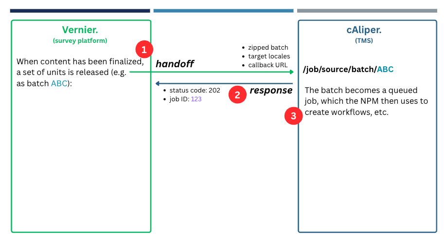
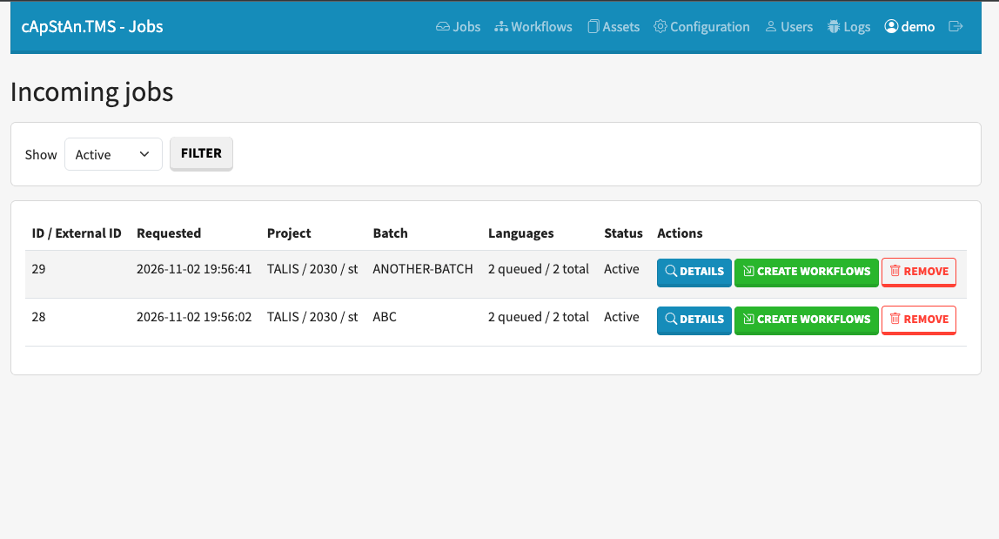
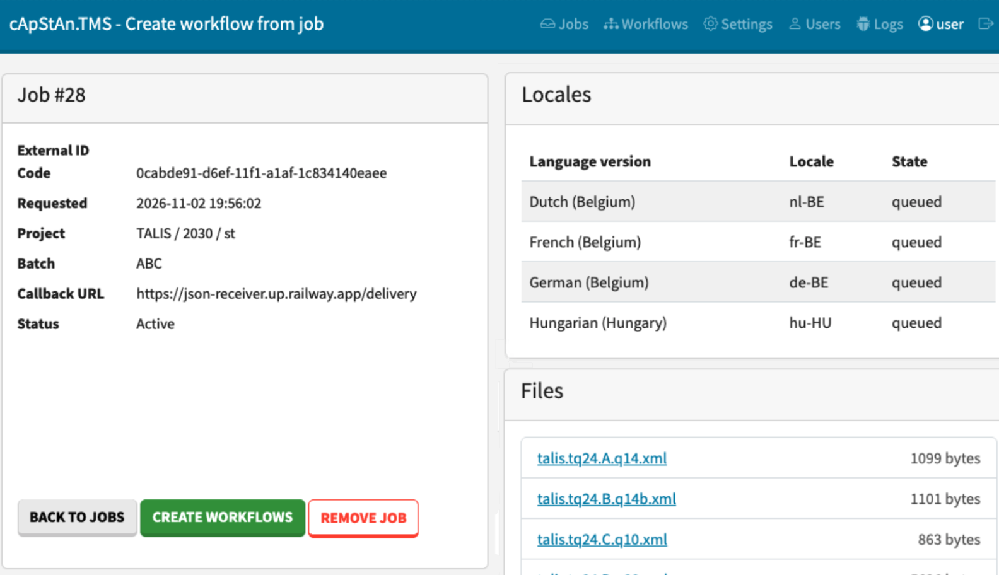

# Jobs

Translation requests from users or clients are organized in "jobs". This section of the guide discusses jobs.

## Understanding jobs

When a batch is released by the survey platform, it is sent to cAliper with the list of expected target locales and associated information. cAliper registers it as a job with a status indicating that it is available for processing.

> The batch may also be uploaded by a cAliper user (e.g. the PA).

The list of incoming jobs provides an overview of the jobs and provides information such as the job ID, external ID, request date, program, batch, number of locales, status and available actions.

<!-- external ID? -->

/// caption
The **Create workflows** button is active before creating workflows for a job.
///

## Viewing job details

Click on **Details** to inspect a job before creating its workflows. The job details include identifying information such as the program, batch, callback URL and status. The locale list shows each target language and its current state; the files section lists the files included in the batch.

!!! tip "NPM"
    Check the job details to confirm that you are working on the intended batch and to see which locales remain queued.

## Creating workflows

To create workflows for a job, click on the **Create workflows** button. 

<!-- 
[Continue to Job creation :material-arrow-right:](jobs.md)

[See Job assignment :material-link-variant:](workflow.md#job-assignment)
-->

[Next: Workflows :material-arrow-right:](03_workflows.md){ .md-button }