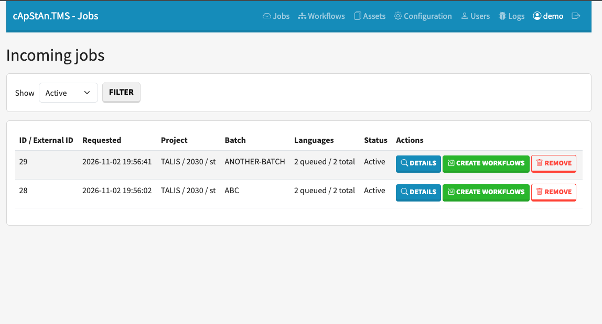
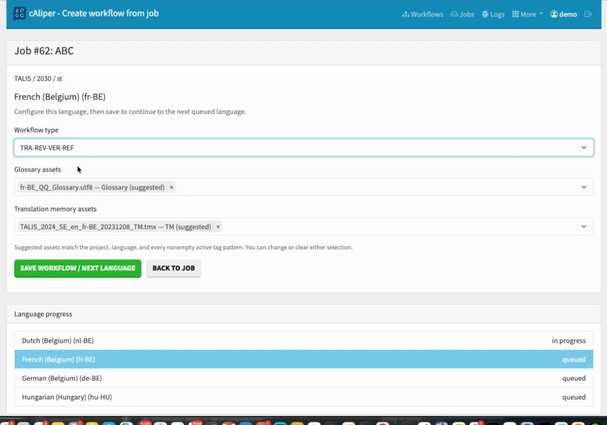
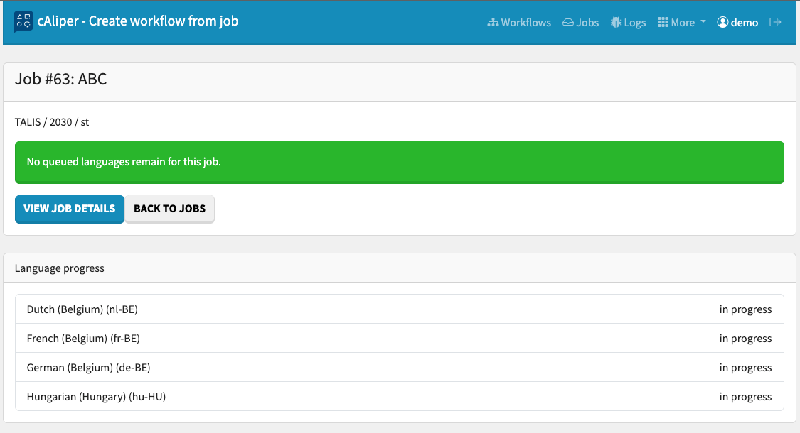
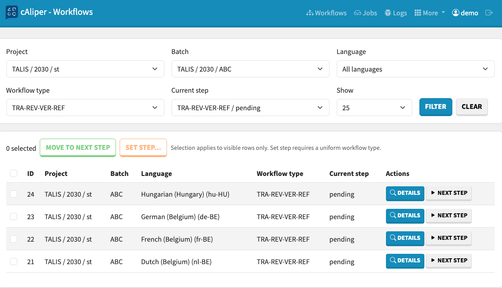
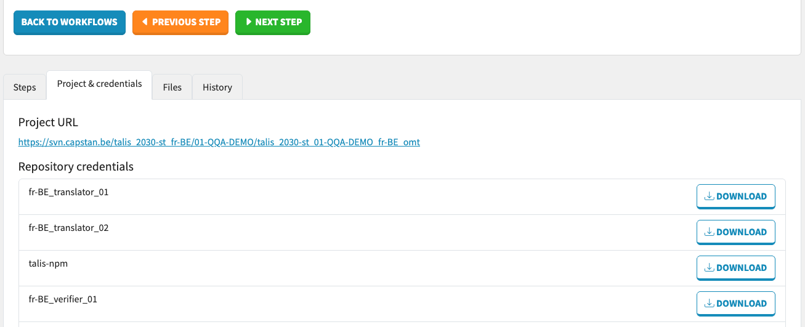
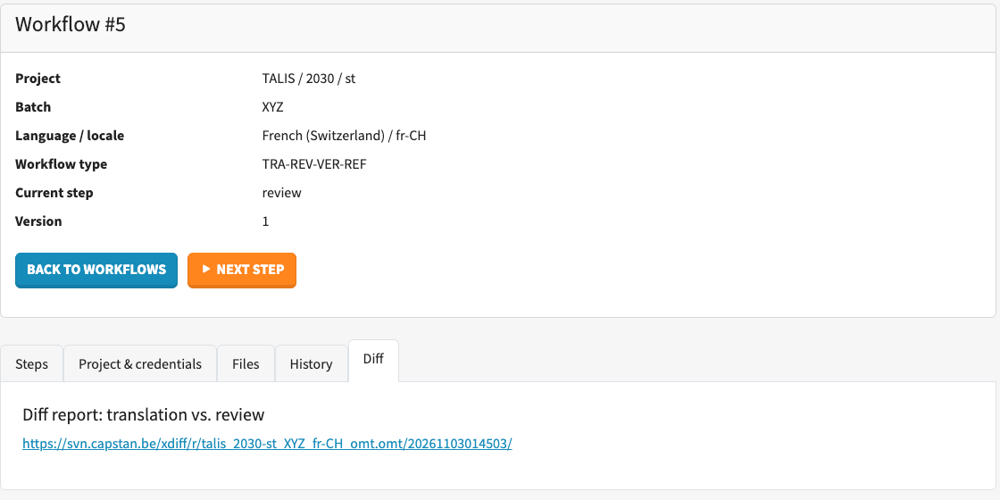
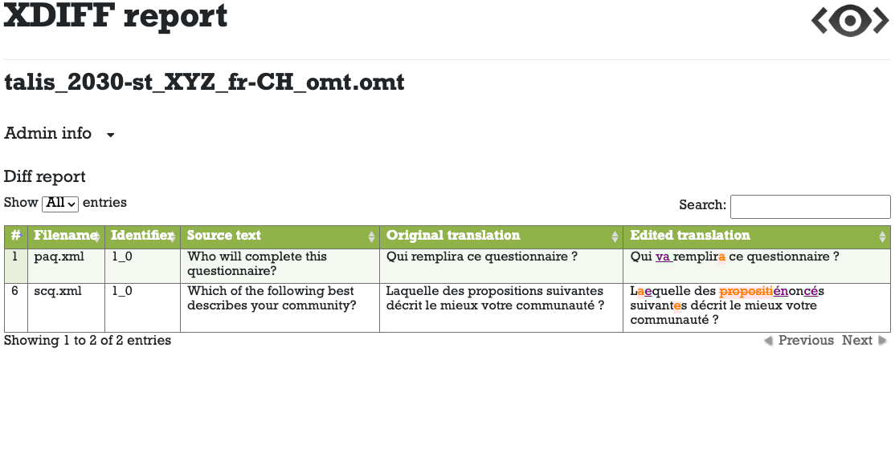
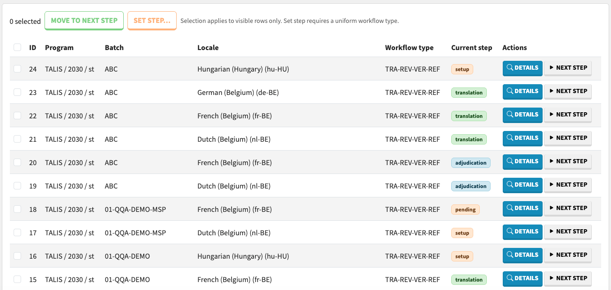
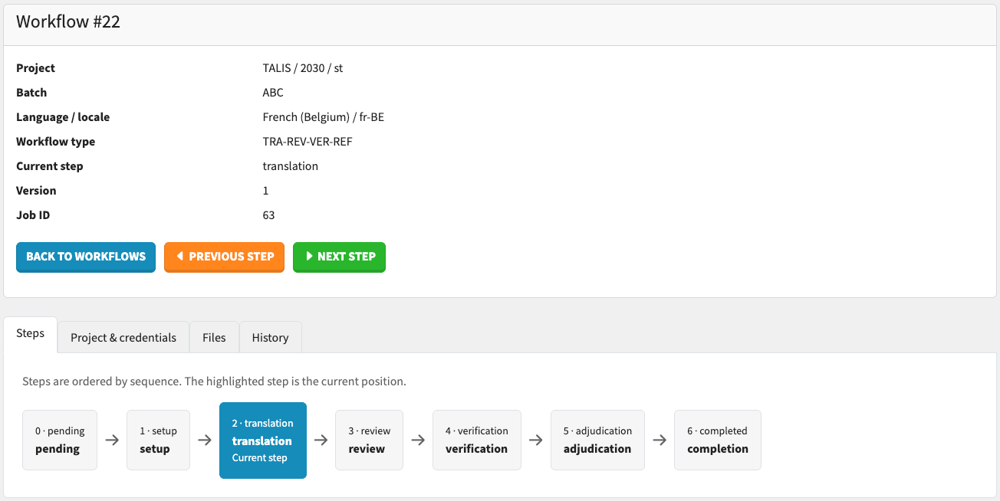
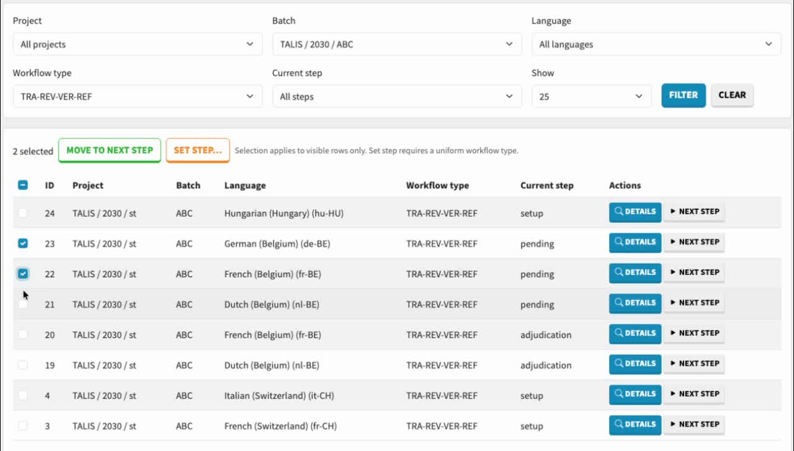

# Workflows

A new job means that the client or the user has requested the translation of a batch into a number of target languages (or locales). To process the batch in each locale, a workflow must be created for that locale. A workflow is, therefore, the mechanism to manage and monitor each of the translations of a given batch or job. This section discusses workflows.

## Creating workflows

The NPM processes the locales in a job one by one. A separate workflow must be created explicitly for each locale. This allows the NPM to confirm or customise the language assets for that particular project.

The NPM may skip a locale and move to the next queued locale. If a locale is skipped in this workflow creation sequence, a workflow is not created for that locale. The NPM may return to it later if it needs to be processed.

<!-- 
!!! info
    Before creating workflows, the NPM should:

    - Confirm that the correct job and batch have arrived.
    - Check which locales need to be processed.
    - Confirm that the necessary language assets are available.
    - Check that the users needed for the workflow exist and have the appropriate scope, locale and step assignments.
    - Confirm with the PA that an appropriate active workflow type is available.
--> 

To start, select **Create workflows** for the queued job to be processed, or open the job details and select **Create workflows** there.

### Configure each workflow

For each queued locale:

1. Make sure the locale displayed is the intended target language.
2. Select the appropriate workflow type.
3. Review the suggested language assets (glossaries, TMs, notes), if any, and remove them or add more as needed.
4. Select **Save workflow / Next language** to save the workflow for this locale and continue to the next queued locale.

Repeat the sequence above until all locales that should be processed have a workflow and appear "in progress". When no queued locales remain, cAliper will indicate that there are no "queued" locales left for the job. The progress area shows the state of the locales processed so far.

/// caption
The progress area on the right-hand side shows the state of the locales processed so far.
///

!!! success "Important"
    Creating a workflow for one locale does not create workflows for the other locales in the same job. Check the progress list to ensure that every locale requiring work has been handled.

## Workflow management

The Workflows view displays the list of workflows, which allows the PA or NPM to keep track of the progress of each locale for each batch.

### Workflow list and filters

!!! info inline end
    The PA can view all locales. The NPM sees only the locales belonging to their country or region. 
    
Open the **Workflows** section to monitor the workflows available within your scope. The list can be filtered by fields such as program, batch, locale, workflow type, or current step. You can also select how many rows to display before applying the filters. 

For each workflow, the list of workflows shows the workflow ID, program, batch, locale, workflow type, current step and available actions.

/// caption
The Workflows view shows the list of workflows and the filter criteria.
/// 

### Workflow properties

Click on **Details** to open an individual workflow. The upper section of the page shows the constant properties of the workflow such as the program, batch, locale, version and job ID.

The lower part includes the following tabs:

#### Steps

The **Steps** tab shows the sequence of steps in the workflow and the current step is highlighted (see [Monitoring progress](#monitoring-progress) below). The buttons **Previous step** and **Next step** allow to move the workflow on this page.

#### Project & Credentials

The **Project & Credentials** tab displays the project URL(s) and the credentials associated with the project(s) that the OmegaT users must use to authenticate. There are different credentials for each step.

/// caption
The **Project** tab shows the project URL and the credentials.
///

#### Files

The **Files** tab shows the files included in the batch submitted for translation. You may download the files directly from here if you need to inspect them or share them with other parties who don't have access to the OmegaT project.

#### History

The **History** tab shows a record or log of the events performed in this workflow: files downloaded, transitions, setup, etc. as well as who triggered them and when. 

#### Diff (versions)

When a workflow has more than one language task (e.g. translation and an editing task) and the linguist responsible for the editing task made some changes to the translation, a diff report may be requested comparing those two steps. 

Diff reports may be requested to compare any pair of steps in the workflow. All generated diff reports are available under this the **Diff** tab.

<!-- todo: configure what two steps must be compared -->
<!-- todo: form where the user selects two steps, button Submit, sends request to xDiff API and receives the report as JSON or the link to the xDiff report in cApps, or both -->

/// caption
Generated diff reports are available in the Diff tab.
/// 
<!-- 
 provides a link to the report comparing translation versions at different workflow stages
-->

The diff report has a tabular form, including columns for the  filename and the segment identifier alongside the source text, the original version and the edited version. This allows the NPM to inspect what changed between the two compared steps without opening the translation project in OmegaT.

 
/// caption
Example of diff report showing changes in two segments.
///

### Monitoring progress

The list of workflows provides an overview of the status of all the visible workflows. 

In particular, the **Current step** column indicates where each workflow is in its sequence of pre-defined steps. The step sequence is also displayed in the workflow details, with the current step highlighted.

/// caption
The **Current step** column shows each workflow's status
///

!!! tip inline end
    Filter by current step to focus on workflows that are at the same step.

The information about the current step information helps you identify workflows that are waiting for a language task to be finalized, have not yet moved beyond setup, or have reached a later stage. The workflow list is also where you can select workflows for bulk actions.

Click on **Details** to inspect an individual workflow. In particular, the **Steps** tab shows the sequence of steps, where the current step is highlighted.

/// caption
The current step is highlighted in blue.
/// 

## Actions

The **Actions** column in the list of workflows includes two buttons in each row: 

- **Details**: opens the Workflow page
- **Next step**: moves the workflow to the next step

The Workflow page displays several buttons: 

- **Back to workflows**: returns to the list of workflows
- **Previous steps**: moves the workflow to the previous step
- **Next step**: moves the workflow to the next step

A workflow must go through all its steps to be finalized. For language tasks, the workflow moves forward naturally as linguists finalize the task in OmegaT. However, it's also possible to move a workflow forward or backward manually in cAliper if needed: 

- Click on the **Next step** button (either in the workflow page or the list of workflows) if you do not wish the linguist to finalize the task in OmegaT
- Click on the **Previous step** button (in the workflow page) if the workflow must be moved backwards and returned to the previous step, e.g. if something is missing, translation is not complete, there's an issue that the user at the previous step must fix in order to continue with subsequent steps, etc.

### Workflow initialization

After creating a workflow, the current step is **INIT** (or **pending**), which means the workflow is on hold and has not started yet. The NPM is responsible for a couple of actions before any language tasks can take place, namely the NPM must:

- Move the workflow to the **setup** step, so that all OmegaT projects are created and configured accordingly (see [Projects](05_projects.md)).
- After setup is complete, move the workflow to the step after **setup**, so that the task associated with that step may be performed.

!!! note
    After that point, it's still possible for the NPM to trigger other transitions manually from the workflow manager page (as long as the current step is not "required"), but normally that should only be necessary for tasks that are not performed in OmegaT.

### Bulk actions

The workflow list supports selecting multiple rows and applying an action to all of them. The selection applies only to the rows currently visible in the list. 

The actions available to apply in bulk are the following: 

- **Move to next step**: Moves all the selected workflows to the next step.
- **Set step**: Moves all the selected workflows to any step in the workflow (not necessarily the next or the previous one). This operation requires the selected workflows to have a uniform workflow type.

/// caption
Select the workflows you want to apply the same action to.
///

!!! tip
    Before applying a bulk action, check the selected rows carefully, including their locales, workflow types and current steps. Do not assume that selecting workflows on one page selects matching workflows on other pages or outside the current filtered view.

[Next: Transitions :material-arrow-right:](04_transitions.md){ .md-button .md-button-right}