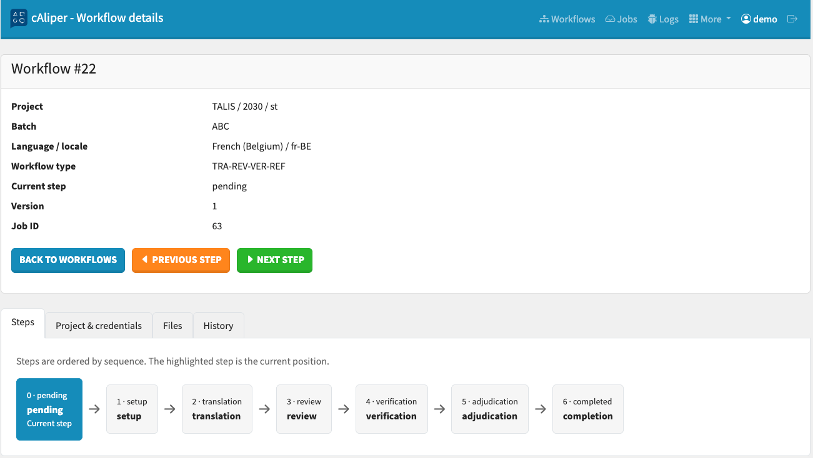
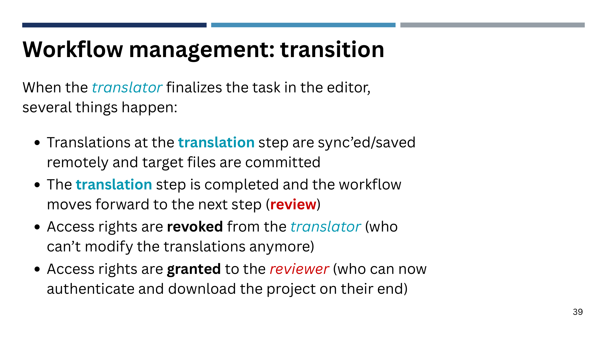
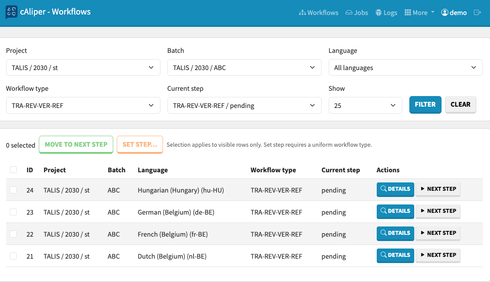
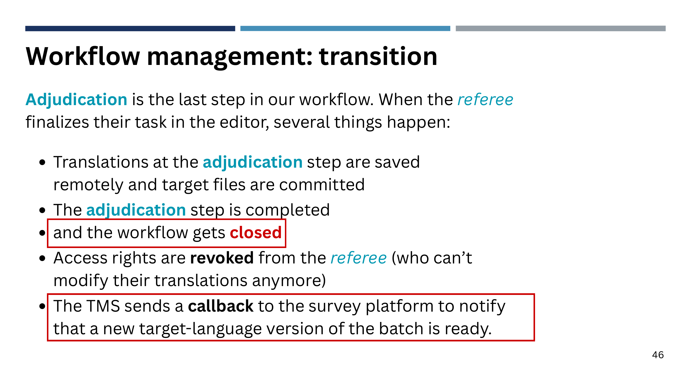
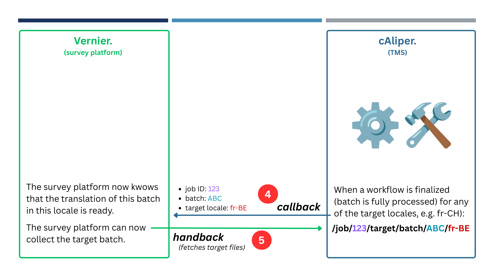

# Workflow transitions

The workflows section of this guide touches briefly on moving workflows forward or backwards. That's what we refer to as a transition (from one step to the next). Typically a transition happens when a workflow moves to the next step. This section discusses transitions in more depth.

## Mandatory manual transitions

Certain transitions (when the current step is not an OmegaT step) can only be triggered manually, for example: 

- From **INIT** (or `pending`) step to **setup**, to create projects (see [Projects](05_projects.md))
- From **setup** step to the next step, to launch the first task

/// caption
The NPM must move the workflow forward to start language tasks.
///

Select **Next step** to move one or more workflows forward. This can be done for one workflow alone or in bulk for several workflows. See the [Workflows > Actions](03_workflows.md#actions) section for more details.

## Transitions after language tasks

For a step configured as a language task performed in OmegaT, the normal way to complete the step is for the assigned user to finalise the task in OmegaT. cAliper then performs the transition to the next step.

When an OmegaT user finalises a task, cAliper:

1. Synchronises/saves the translations remotely and commits the target files.
2. Marks the previous step as completed and moves the workflow to the next step.
3. Revokes the previous user's access rights so that they can no longer modify the translations.
4. Grants access rights to the user assigned to the next step, who can then authenticate and download the project.

<!--  -->

!!! example
    Suppose a **translation** step is finalized in OmegaT and the next step is **review**. Before the task is finalized in OmegaT, the workflow is at **translation** step and the **translator** has access to the project but the **reviewer** does not. When the translator finalizes the task, the workflow moves to **review**, the **translator** loses access to the project and the **reviewer** now has access to the project. The same principle would apply to any other pair of consecutive language tasks.

## Other manual transitions

Other than letting the workflow move forward when the OmegaT user finalizes task in OmegaT, the NPM can also move a workflow forward manually from the cAliper interface when necessary, provided the current step is not marked as **required** :material-shield:.

For example, if the task is a review to be performed by a domain expert based on some offline material (a report, exports, a spreadsheet, etc.), who does not work in OmegaT, the domain expert may finalize the task in cAliper (or the NPM may do so on their behalf).

Or for example, if the linguist has some difficulty connecting to cAliper from OmegaT but has confirmed that their task is complete, the NPM may finalize the task in cAliper on their behalf. This should be exceptional, though.

!!! info 
    A **required** step cannot be skipped manually by the NPM. It can be advanced only when the assigned user finalises the task in OmegaT, or when the PA performs the manual transition in the TMS.

On the other hand, besides transitions to and from **step**, any other tasks that are not OmegaT steps can only be finalized in the workflow manager.

Select **Next step** to move one or more workflows forward. This can be done for one workflow alone or in bulk for several workflows. See the [Workflows > Actions](03_workflows.md#actions) section for more details.

<!--  -->

<!-- Use manual forward transitions only when the work required at the current step has been completed or when the applicable project procedure explicitly allows the step to be bypassed. Do not use the control as a substitute for an OmegaT user's task finalisation when that task is required. -->

## Backward transitions

A backward transition is intended for correcting an omission or problem from an earlier step. For example, if something that should have been completed during translation was missed and is discovered during review, the NPM may return the workflow to the previous step (translation) so that the issue can be amended before the next task is performed.

!!! note "NPM"
    Use **Previous step** only when there is a specific reason to return a workflow to an earlier stage. Identify what needs to be corrected and provide instructions for the user responsible for that step. Once the correction is complete, the workflow can proceed through the normal process again.

<!-- comment: in the transition on the TMS = instruction to the user -->

## Completion and handback

When the last task is finalised, the workflow gets closed (and, if it was a language task performed in OmegaT, translations and target files are saved in the system, and access rights are revoked from the last user). At that point, unlike in other transitions, cAliper sends a callback to the survey platform to indicate that a new target version of the batch is ready and available for collection. 

The survey platform can then collect the target files through the API. This completion and handback process applies to each locale in the job -- a job requested in multiple locales is not fully processed until all locales have been completed.

<!--  -->

> If the job was created by a user upload, the translated batch becomes available for download in cAliper in the Files section of the workflow.

[Next: Projects :material-arrow-right:](05_projects.md){ .md-button .md-button-right}