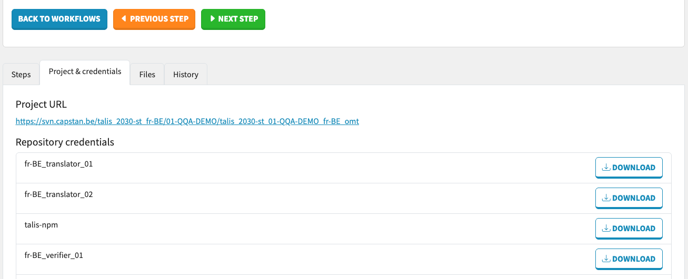
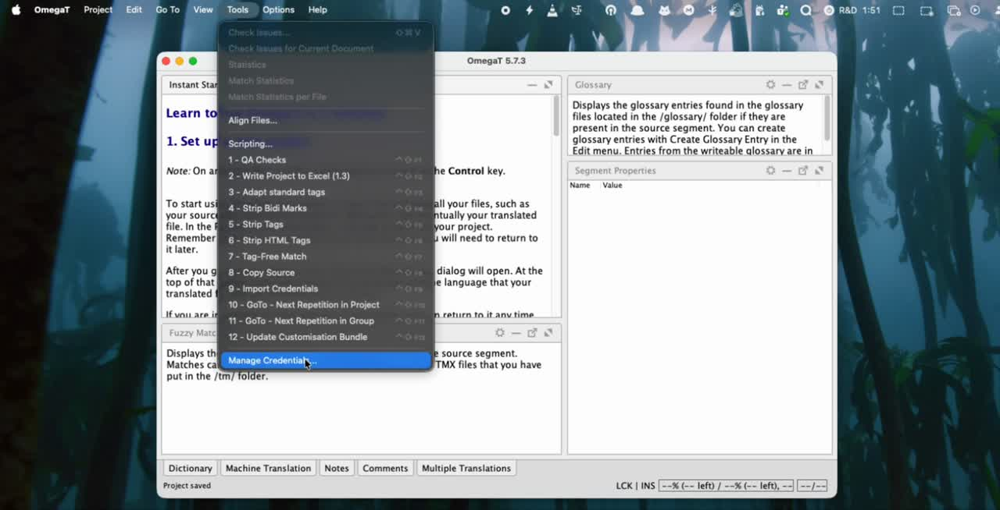
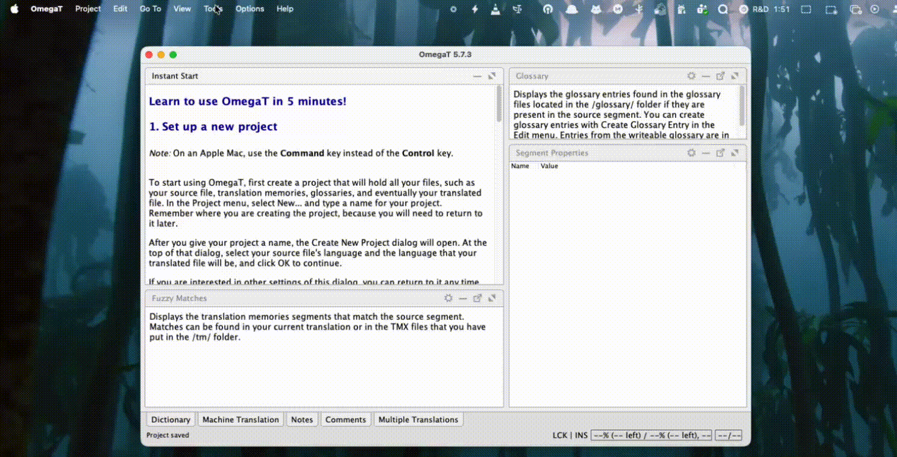
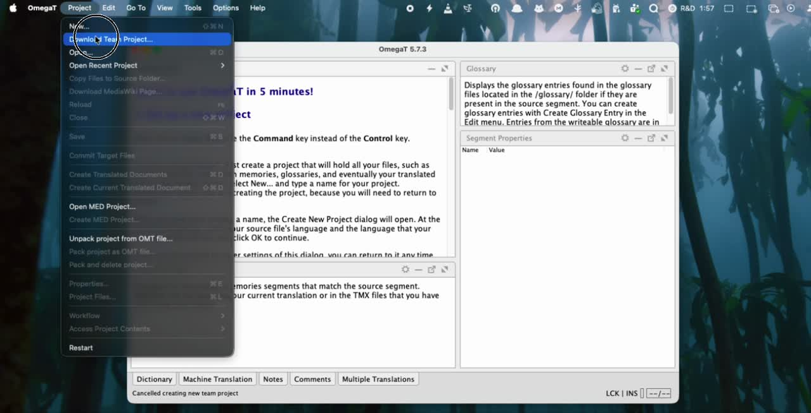
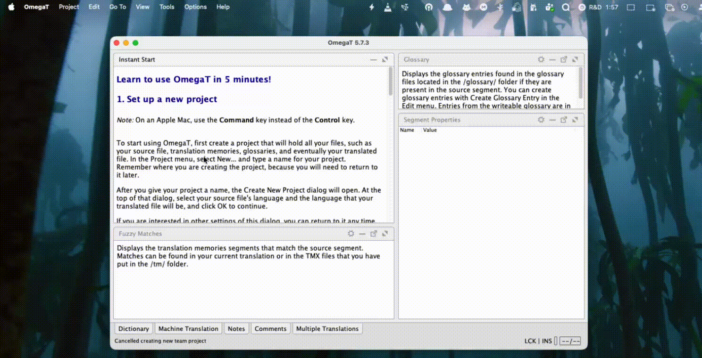
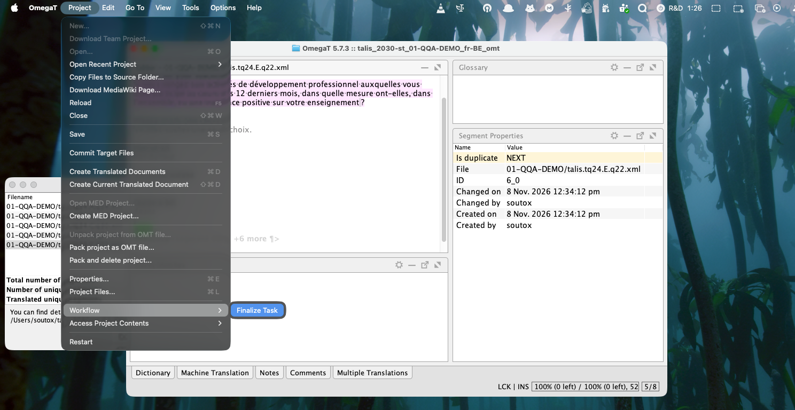
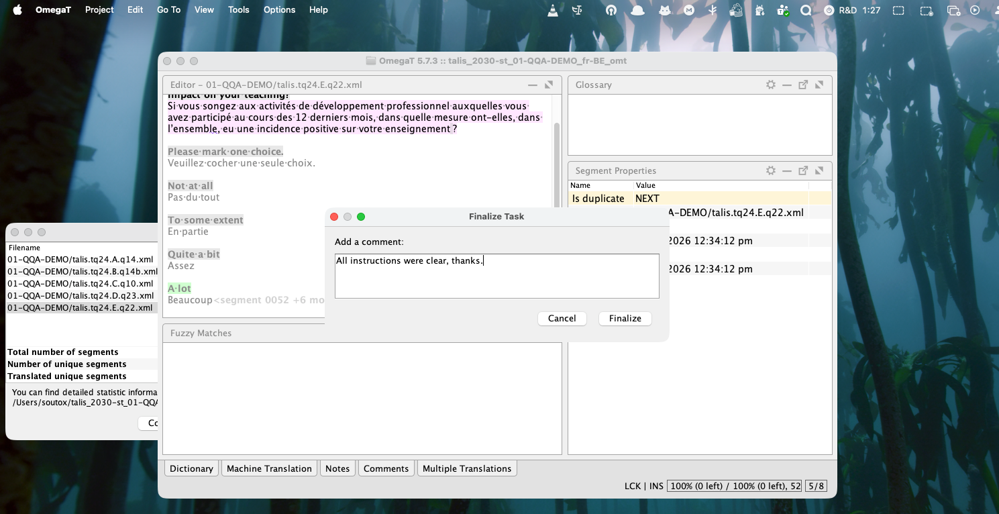
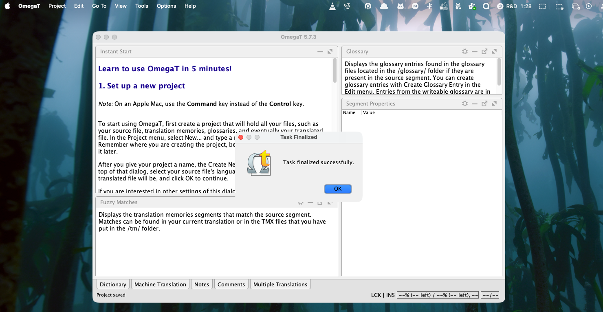

# Translation projects

Language tasks take place in a translation editor (or, rather, a CAT tool, of which the translation editor is the main component but which includes many other utilities that optimize the task of the linguists, e.g. increasing quality, reducing effort, etc).

> Translation projects in cAliper are OmegaT team projects, hosted in a remote repository, to which OmegaT connects to fetch the project and to keep the project sync'ed with the latest changes.

## Project setup

OmegaT translations are created to accommodate translation and the rest of language tasks, following the translation industry standards in terms of working environment best practices. Depending on the workflow shape, either four or one projects are created per workflow.

!!! info "Workflow shape"
    cAliper supports two types of worklows, depending on the workflow's shape: linear (i.e. `-----`) and Y-shaped (i.e. `>----`). The difference is that Y-shaped workflows include a double-step composed of two twin translation steps (called "double-translation"), followed by a so-called "reconciliation" step where the two initial translations are merged, whereas linear workflows are based on a single translation.

    OmegaT projects are created for a specific batch+locale combination in so-called "linear workflows" and there's one single project per workflow. On the other hand, in Y-shaped workflows, projects are created for a specific batch+locale+step combination, whereby three separate projects are created for the double translation step and for reconciliation, on the one hand, and one forth project is created for the rest of steps, on the other hand.

OmegaT projects are created and configured as expected (depending on the properties selected during the creation of the workflow) when the workflow reaches the **setup** step (see [Workflows > Initialization](../03_workflows#workflow-initialization) and [Transitions > Mandatory Manual Transitions](../04_transitions#mandatory-manual-transitions)).

## Project details

The workflow page has several tabs for different details, one of which shows the **Project & Credentials** section, which displays the project URL(s) and the credentials associated with the project(s). Credentials are listed individually and can be downloaded using the corresponding **Download** control.

/// caption
The **Project** tab shows the project URL and the credentials.
///

The NPM must share the project URL and the credentials file with each user so that they can access the project and commit their work in it.

## User authentication

> This section covers only the OmegaT actions that affect workflow coordination. It does not explain how to translate, review or edit content. Users performing language tasks should refer to the separate [OmegaT guides](https://capstanlqc.github.io/omegat-guides/en/) for those instructions.

When a workflow reaches an OmegaT step, cAliper grants access to the user assigned to that step. The user must import in OmegaT the credentials provided to them for their step before accessing the repository.

<!--  -->

/// caption
The user imports credentials in **Tools** > **Manage credentials**.
///

<!--  -->

!!! info "NPM"
    The NPM is responsible for sharing the project URL and the credentials with the correct user(s) assigned to each step.

## Project access

After importing the credentials, OmegaT can now authenticate to the TMS when the user downloads the team project using **Project > Download Team Project**. After the project has been downloaded, the user performs the assigned task.

<!--  -->

/// caption
The user downloads the project in **Project** > **Download Team Project**.
///

!!! info 
    Only the user assigned to the current step in the workflow can access the project. Users assigned to other users cannot access the project (anymore or not yet), which prevents collision of tasks. Different users assigned to the same step can, however, access the team project at the same time and team up to accomplish the task.

## Finalising a task

When the language task is complete, the OmegaT user selects **Project > Workflow > Finalize Task**. 

/// caption
**Project** > **Workflow** > **Finalize Taks**
///

The user can enter a comment in the finalisation dialog and then confirm by selecting **Finalize**.

/// caption
Add comment for the NPM or the next step's user.
///

OmegaT displays a confirmation when the task has been finalised successfully.

/// caption
Task finalized successfully.
///

The successful finalisation triggers the cAliper transition described in [Transitions after language tasks](../04_transitions#transitions-after-language-tasks). The NPM should verify that the workflow has advanced to the expected next step and that the next user can access the project.